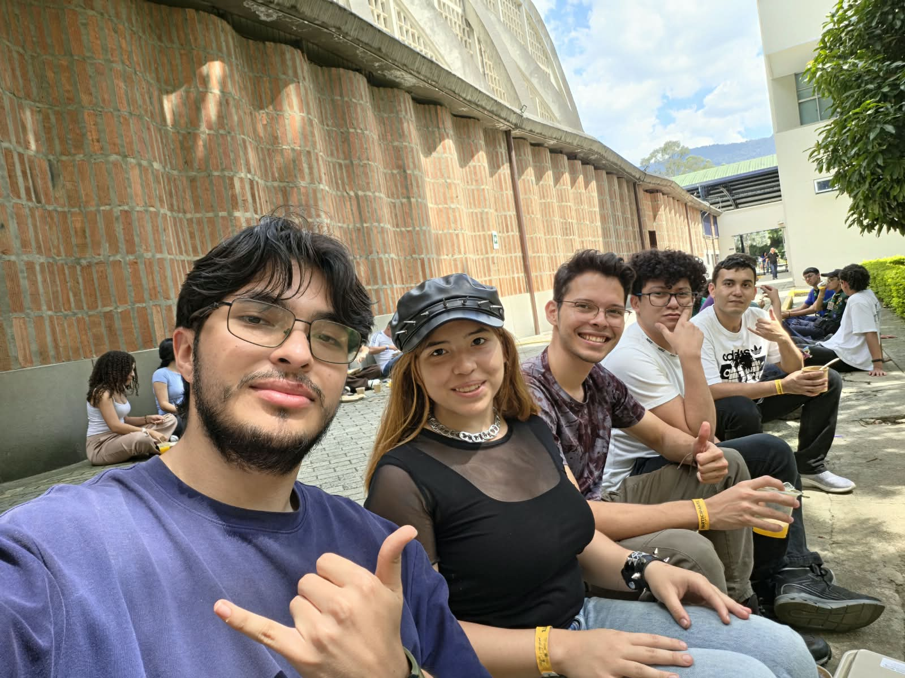

# 1luz_sideral

Interactive web app that uses NISAR (NASA-ISRO SAR) radar data to track and visualize surface-water change.
Built for NASA Space Apps Challenge 2026 · *Dancing with the SARs*.

**Documentation:** https://1luz-sideral.readthedocs.io/en/latest/

## Features

- Map with study areas and points of interest (square extents, draggable center and corners).
- Search bar for place names (Nominatim), natural features and land-cover classes.
- Water layers: NISAR GCOV (preview), OPERA DSWx-S1 (NASA GIBS) and JRC historical water.
- Timeline of NISAR overpasses (ascending/descending) with step controls and preloaded playback animation.
- NISAR data download for a point of interest, with HH/HV/VV/VH polarization selection.
- Water-probability detection with a U-Net model on NISAR HH backscatter ("Water (U-Net)").
- "Own model" mode: run a model on your machine and connect it to the app over HTTP.
- Guided onboarding tour (driver.js) and an "About" section explaining SAR and polarization.

## Data

- **NISAR L2 GCOV** products, found through NASA CMR / `asf_search` and read with HTTP range requests.
- Optical context: Sentinel-2 cloudless mosaic (EOX). Water references: OPERA DSWx-S1, JRC.
- NISAR access requires a free NASA Earthdata login. Set `EARTHDATA_USERNAME` and `EARTHDATA_PASSWORD`
  (environment or `backend/.env`). At startup, if no `~/.netrc` or `NETRC` exists, the backend writes a
  temporary netrc from these variables and exports `NETRC`.

## Method

- **Why SAR:** active microwave sensing works day and night and through clouds. Water has a high dielectric
  constant and a smooth surface, so it shows dark (low backscatter) in co-polarized images.
- **Polarization:** HH (horizontal transmit/receive) is sensitive to rough surfaces and soil structure;
  HV (cross-pol) is sensitive to vegetation volume and biomass. Comparing both separates bare soil from canopy.
- **Water U-Net** (`NISAR_UNET_MODELO_V1`): 1-channel UNet trained on Okavango HH data. The backend reads HH
  power, averages to 30 m, converts to dB, normalizes, and tiles predictions with a Hann window.
  Output is a water-probability PNG plus water and valid-data fractions.

## Architecture

| Part | Role |
|---|---|
| `backend/` | FastAPI app under `/api`: NISAR search, scenes, jobs, estimate, land cover, DEM, samples, features, regions, `/api/water` (U-Net), `/api/models` (external model contract). Serves the built frontend when `STATIC_DIR` is set. |
| `frontend/` | React 19 + TypeScript + Vite, MapLibre GL via react-map-gl, lucide-react icons, driver.js tour. |
| `model_service/` | Standalone U-Net water client (`python -m water_unet`) that pulls jobs from the backend. See `model_service/README.md`. |
| `notebooks/` | Team research notebooks and scripts (NISAR extractor, OPERA, training data catalog, GIS layer notes). |
| `scripts/` | `deploy_lightsail.sh` deployment script. |

Stack: Python 3.12, FastAPI, uvicorn, rasterio, h5py, PyTorch (CPU), asf_search, harmony-py; Node 22, React, Vite.

## Run locally

Backend (port 8000):

```bash
cd backend
python -m venv .venv
.venv/Scripts/activate            # Windows; `source .venv/bin/activate` elsewhere
pip install torch --index-url https://download.pytorch.org/whl/cpu
pip install -e ".[dev]"
# create backend/.env with EARTHDATA_USERNAME=... and EARTHDATA_PASSWORD=...
uvicorn app.main:app --reload --port 8000
```

Frontend (Vite dev server, proxies `/api` to `http://localhost:8000`):

```bash
cd frontend
npm install
npm run dev
```

Tests: `cd backend && pytest`.

Optional backend settings: `DATA_DIR` (default `data`), `CORS_ORIGINS` (default `http://localhost:5173`),
`NETRC`, `STATIC_DIR`.

## Docker and deployment

The root `Dockerfile` builds one image: it builds the frontend with Node, installs the backend with CPU
PyTorch, and serves both from FastAPI on port 8000.

```bash
docker build -t luzsi .
docker run -p 8000:8000 -e EARTHDATA_USERNAME=... -e EARTHDATA_PASSWORD=... luzsi
```

Production runs on an AWS Lightsail container service. `scripts/deploy_lightsail.sh` builds the image,
pushes it to ECR, reads Earthdata credentials from SSM Parameter Store and creates a new deployment.
It needs a running Docker daemon and AWS credentials.

## Project structure

```
backend/        FastAPI API, NISAR extractor, U-Net water service, tests
frontend/       React + MapLibre web app
model_service/  standalone U-Net client for the "own model" mode
notebooks/      team research work
scripts/        deployment
Dockerfile      single-image build
```

## Team



## License

No license file is included yet. The project is intended to be open source.

## Docs

Full documentation: https://1luz-sideral.readthedocs.io/en/latest/
